# Resultados consolidados
Gerado por `python -m fraude consolidate` a partir de `reports/` e `artifacts/`. As tabelas estão também em `tabelas/` (CSV com vírgula decimal) e as figuras em `figuras/`.

## Bases de dados

**Tabela 1** – Bases utilizadas, após a remoção de duplicatas
| Base | Amostra | Transações | Fraudes | Taxa de fraude (%) | Atributos de entrada | Duplicatas removidas | Fraudes duplicadas removidas |
|---|---|---|---|---|---|---|---|
| ULB (cartão de crédito) | 100% | 275.663 | 473 | 0,1716 | 30 | 9.144 | 19 |
| PaySim sem saldo da origem | 20% | 554.082 | 1.643 | 0,2965 | 6 | 0 | 0 |
| PaySim completo | 20% | 554.082 | 1.643 | 0,2965 | 8 | 0 | 0 |
No PaySim, só operações TRANSFER e CASH_OUT, em amostra estratificada. Fonte: elaborado pelo autor.

## Efeito das transações duplicadas (ULB)

Na execução sem deduplicação, 8 das 98 fraudes do conjunto de teste tinham uma cópia exata (mesmos atributos e rótulo, ignorando o instante) no treino.

**Tabela 2** – AUC-PR com e sem a remoção das duplicatas, por configuração (ULB)
| Configuração | AUC-PR CV (com dup.) | AUC-PR CV (sem dup.) | AUC-PR teste (com dup.) | AUC-PR teste (sem dup.) | Diferença no teste |
|---|---|---|---|---|---|
| XGBoost + Sensível a custo (pesos) | 0,849 | 0,856 | 0,885 | 0,843 | -0,041 |
| LightGBM + SMOTE | 0,857 | 0,857 | 0,882 | 0,842 | -0,040 |
| XGBoost + SMOTE | 0,856 | 0,855 | 0,875 | 0,840 | -0,035 |
| XGBoost + Sem tratamento | 0,851 | 0,853 | 0,873 | 0,840 | -0,033 |
| LightGBM + Sem tratamento | 0,851 | 0,856 | 0,878 | 0,829 | -0,049 |
| LightGBM + Sensível a custo (pesos) | 0,837 | 0,843 | 0,844 | 0,825 | -0,020 |
| XGBoost + Subamostragem aleatória | 0,834 | 0,844 | 0,855 | 0,825 | -0,030 |
| Random Forest + SMOTE | 0,851 | 0,851 | 0,876 | 0,822 | -0,054 |
| LightGBM + Subamostragem aleatória | 0,829 | 0,850 | 0,864 | 0,821 | -0,043 |
| Random Forest + Sem tratamento | 0,838 | 0,841 | 0,875 | 0,819 | -0,056 |
| Random Forest + Sensível a custo (pesos) | 0,838 | 0,838 | 0,855 | 0,819 | -0,036 |
| MLP (rede neural) + Sensível a custo (pesos) | 0,825 | 0,821 | 0,824 | 0,815 | -0,008 |
| MLP (rede neural) + SMOTE | 0,823 | 0,822 | 0,829 | 0,814 | -0,015 |
| MLP (rede neural) + Sem tratamento | 0,837 | 0,829 | 0,868 | 0,811 | -0,057 |
| Random Forest + Subamostragem aleatória | 0,792 | 0,828 | 0,825 | 0,787 | -0,038 |
| Regressão Logística (referência) + SMOTE | 0,761 | 0,746 | 0,742 | 0,733 | -0,009 |
| Regressão Logística (referência) + Sem tratamento | 0,763 | 0,752 | 0,742 | 0,732 | -0,010 |
| Regressão Logística (referência) + Subamostragem aleatória | 0,764 | 0,744 | 0,745 | 0,731 | -0,015 |
| Regressão Logística (referência) + Sensível a custo (pesos) | 0,748 | 0,735 | 0,709 | 0,697 | -0,012 |
| MLP (rede neural) + Subamostragem aleatória | 0,786 | 0,735 | 0,694 | 0,672 | -0,022 |
| Isolation Forest (não supervisionado) + Sem tratamento | 0,294 | 0,266 | 0,330 | 0,238 | -0,091 |
Diferença média no teste: -0,034; na validação cruzada: -0,003. Fonte: elaborado pelo autor.

## Comparação dos algoritmos — ULB (cartão de crédito)

**Tabela 3** – Desempenho no conjunto de teste — ULB (cartão de crédito)
| Algoritmo | Balanceamento | AUC-PR CV | AUC-PR teste [IC 95%] | AUC-ROC | Precisão | Revocação | F1 | MCC | Latência (ms) |
|---|---|---|---|---|---|---|---|---|---|
| XGBoost | Sensível a custo (pesos) | 0,856 ± 0,024 | 0,843 [0,774; 0,906] | 0,983 | 0,802 | 0,811 | 0,806 | 0,806 | 2,07 |
| LightGBM | SMOTE | 0,857 ± 0,023 | 0,842 [0,770; 0,905] | 0,968 | 0,736 | 0,853 | 0,790 | 0,792 | 2,18 |
| XGBoost | SMOTE | 0,855 ± 0,024 | 0,840 [0,773; 0,903] | 0,981 | 0,844 | 0,800 | 0,822 | 0,822 | 2,06 |
| XGBoost | Sem tratamento | 0,853 ± 0,028 | 0,840 [0,771; 0,900] | 0,981 | 0,835 | 0,800 | 0,817 | 0,817 | 2,05 |
| LightGBM | Sem tratamento | 0,856 ± 0,028 | 0,829 [0,754; 0,895] | 0,974 | 0,772 | 0,821 | 0,796 | 0,796 | 2,32 |
| LightGBM | Sensível a custo (pesos) | 0,843 ± 0,023 | 0,825 [0,750; 0,892] | 0,931 | 0,670 | 0,811 | 0,733 | 0,736 | 2,21 |
| XGBoost | Subamostragem aleatória | 0,844 ± 0,028 | 0,825 [0,753; 0,891] | 0,979 | 0,661 | 0,821 | 0,732 | 0,736 | 2,05 |
| Random Forest | SMOTE | 0,851 ± 0,026 | 0,822 [0,749; 0,887] | 0,980 | 0,696 | 0,821 | 0,754 | 0,756 | 15,28 |
| LightGBM | Subamostragem aleatória | 0,850 ± 0,028 | 0,821 [0,750; 0,888] | 0,977 | 0,622 | 0,832 | 0,712 | 0,719 | 2,16 |
| Random Forest | Sem tratamento | 0,841 ± 0,031 | 0,819 [0,742; 0,886] | 0,952 | 0,729 | 0,821 | 0,772 | 0,773 | 15,26 |
| Random Forest | Sensível a custo (pesos) | 0,838 ± 0,030 | 0,819 [0,745; 0,888] | 0,963 | 0,648 | 0,832 | 0,728 | 0,733 | 14,71 |
| MLP (rede neural) | Sensível a custo (pesos) | 0,821 ± 0,031 | 0,815 [0,743; 0,883] | 0,959 | 0,632 | 0,832 | 0,718 | 0,724 | 1,56 |
| MLP (rede neural) | SMOTE | 0,822 ± 0,032 | 0,814 [0,740; 0,885] | 0,958 | 0,681 | 0,811 | 0,740 | 0,743 | 1,54 |
| MLP (rede neural) | Sem tratamento | 0,829 ± 0,019 | 0,811 [0,737; 0,883] | 0,969 | 0,519 | 0,842 | 0,643 | 0,661 | 1,55 |
| Random Forest | Subamostragem aleatória | 0,828 ± 0,028 | 0,787 [0,709; 0,861] | 0,981 | 0,748 | 0,811 | 0,778 | 0,778 | 15,21 |
| Regressão Logística (referência) | SMOTE | 0,746 ± 0,044 | 0,733 [0,640; 0,830] | 0,979 | 0,624 | 0,821 | 0,709 | 0,715 | 1,64 |
| Regressão Logística (referência) | Sem tratamento | 0,752 ± 0,040 | 0,732 [0,642; 0,826] | 0,969 | 0,579 | 0,853 | 0,689 | 0,702 | 1,56 |
| Regressão Logística (referência) | Subamostragem aleatória | 0,744 ± 0,047 | 0,731 [0,641; 0,824] | 0,984 | 0,590 | 0,832 | 0,690 | 0,700 | 1,86 |
| Regressão Logística (referência) | Sensível a custo (pesos) | 0,735 ± 0,056 | 0,697 [0,601; 0,802] | 0,982 | 0,598 | 0,832 | 0,696 | 0,705 | 1,53 |
| MLP (rede neural) | Subamostragem aleatória | 0,735 ± 0,046 | 0,672 [0,568; 0,770] | 0,938 | 0,802 | 0,768 | 0,785 | 0,785 | 1,56 |
| Isolation Forest (não supervisionado) | Sem tratamento | 0,266 ± 0,058 | 0,238 [0,165; 0,334] | 0,958 | 0,169 | 0,453 | 0,246 | 0,274 | 3,80 |
Precisão, revocação, F1 e MCC no limiar de custo mínimo do cenário moderado (FN:FP = 20:1), escolhido nas predições out-of-fold do treino. CV: média ± desvio-padrão em 5 partições. Fonte: elaborado pelo autor.

**Figura 1** – AUC-PR no teste por algoritmo e balanceamento — ULB (cartão de crédito)
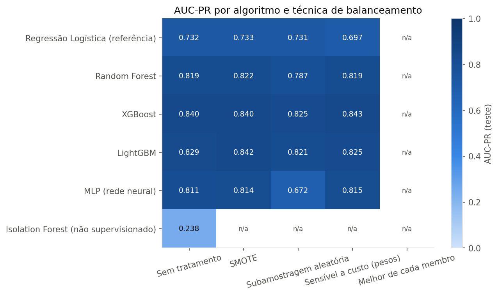
Fonte: elaborado pelo autor.

**Figura 2** – Curvas precisão-revocação no teste — ULB
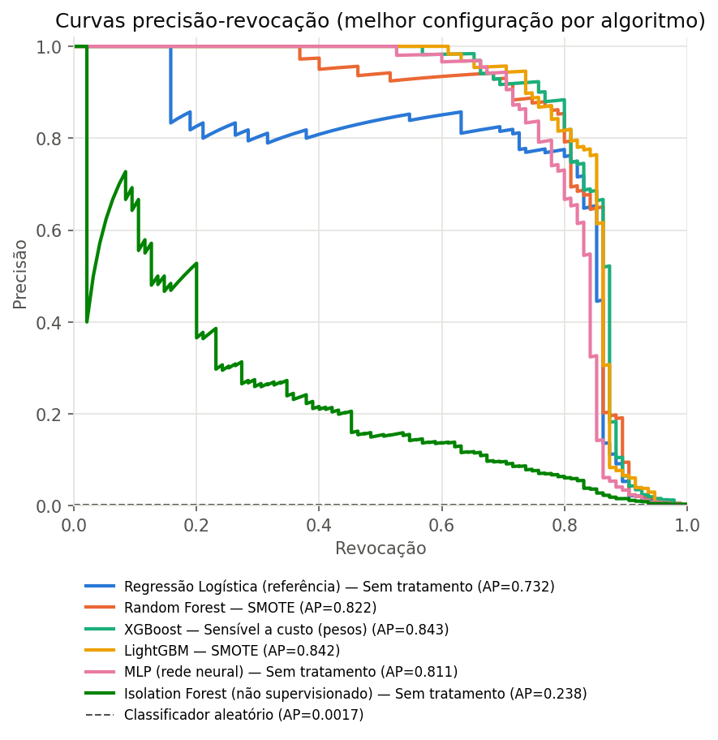
Fonte: elaborado pelo autor.

**Figura 3** – AUC-PR × latência por transação — ULB
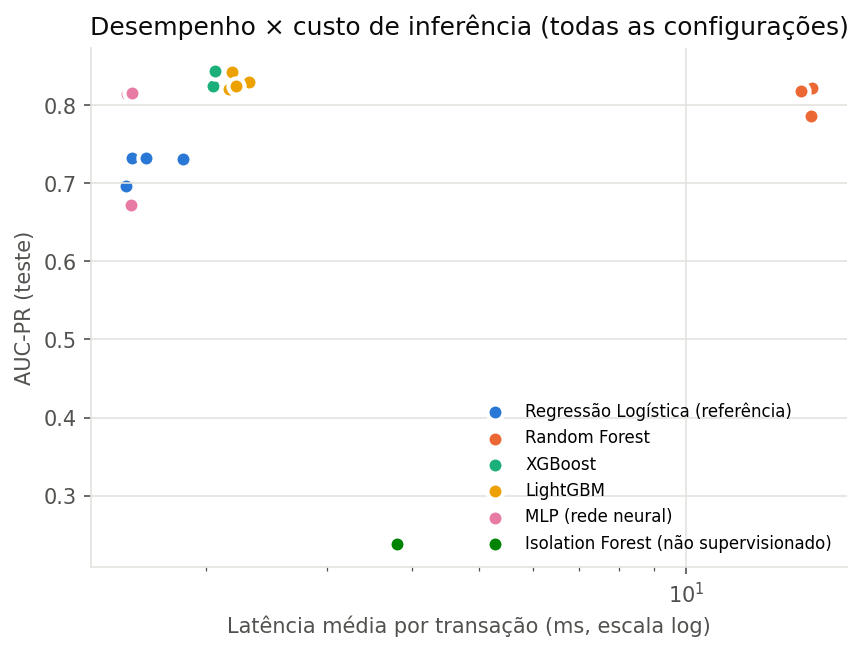
Fonte: elaborado pelo autor.

## Comparação dos algoritmos — PaySim sem saldo da origem

**Tabela 4** – Desempenho no conjunto de teste — PaySim sem saldo da origem
| Algoritmo | Balanceamento | AUC-PR CV | AUC-PR teste [IC 95%] | AUC-ROC | Precisão | Revocação | F1 | MCC | Latência (ms) |
|---|---|---|---|---|---|---|---|---|---|
| XGBoost | Sem tratamento | 0,768 ± 0,012 | 0,806 [0,764; 0,847] | 0,953 | 0,711 | 0,799 | 0,753 | 0,753 | 3,65 |
| MLP (rede neural) | Sem tratamento | 0,763 ± 0,011 | 0,805 [0,764; 0,847] | 0,956 | 0,610 | 0,818 | 0,699 | 0,705 | 2,74 |
| MLP (rede neural) | Sensível a custo (pesos) | 0,757 ± 0,011 | 0,805 [0,765; 0,848] | 0,951 | 0,619 | 0,809 | 0,701 | 0,706 | 2,77 |
| MLP (rede neural) | SMOTE | 0,760 ± 0,013 | 0,802 [0,760; 0,843] | 0,950 | 0,655 | 0,802 | 0,721 | 0,724 | 2,74 |
| Random Forest | Sem tratamento | 0,759 ± 0,012 | 0,802 [0,760; 0,846] | 0,935 | 0,691 | 0,809 | 0,745 | 0,747 | 16,34 |
| XGBoost | SMOTE | 0,760 ± 0,013 | 0,802 [0,759; 0,844] | 0,947 | 0,674 | 0,796 | 0,730 | 0,732 | 3,64 |
| XGBoost | Sensível a custo (pesos) | 0,760 ± 0,012 | 0,801 [0,759; 0,842] | 0,952 | 0,625 | 0,796 | 0,701 | 0,705 | 3,52 |
| XGBoost | Subamostragem aleatória | 0,760 ± 0,013 | 0,800 [0,758; 0,841] | 0,952 | 0,653 | 0,805 | 0,721 | 0,724 | 3,52 |
| Random Forest | SMOTE | 0,761 ± 0,012 | 0,800 [0,757; 0,844] | 0,947 | 0,741 | 0,784 | 0,762 | 0,762 | 16,61 |
| MLP (rede neural) | Subamostragem aleatória | 0,760 ± 0,016 | 0,800 [0,761; 0,841] | 0,951 | 0,859 | 0,760 | 0,806 | 0,807 | 2,80 |
| Random Forest | Subamostragem aleatória | 0,753 ± 0,013 | 0,797 [0,752; 0,839] | 0,944 | 0,705 | 0,784 | 0,742 | 0,743 | 16,54 |
| LightGBM | Sem tratamento | 0,758 ± 0,013 | 0,792 [0,751; 0,834] | 0,947 | 0,685 | 0,775 | 0,728 | 0,728 | 3,58 |
| Random Forest | Sensível a custo (pesos) | 0,754 ± 0,014 | 0,792 [0,748; 0,834] | 0,938 | 0,574 | 0,799 | 0,668 | 0,676 | 16,90 |
| LightGBM | SMOTE | 0,753 ± 0,012 | 0,791 [0,747; 0,833] | 0,951 | 0,596 | 0,793 | 0,681 | 0,687 | 3,55 |
| LightGBM | Subamostragem aleatória | 0,745 ± 0,019 | 0,784 [0,739; 0,826] | 0,947 | 0,652 | 0,781 | 0,711 | 0,713 | 3,57 |
| LightGBM | Sensível a custo (pesos) | 0,734 ± 0,015 | 0,764 [0,720; 0,808] | 0,945 | 0,660 | 0,760 | 0,706 | 0,707 | 3,61 |
| Regressão Logística (referência) | Sem tratamento | 0,584 ± 0,031 | 0,608 [0,556; 0,658] | 0,921 | 0,497 | 0,672 | 0,571 | 0,576 | 2,84 |
| Regressão Logística (referência) | Subamostragem aleatória | 0,576 ± 0,034 | 0,596 [0,544; 0,648] | 0,926 | 0,463 | 0,702 | 0,558 | 0,569 | 2,76 |
| Regressão Logística (referência) | SMOTE | 0,532 ± 0,040 | 0,541 [0,487; 0,598] | 0,933 | 0,521 | 0,708 | 0,601 | 0,606 | 2,72 |
| Isolation Forest (não supervisionado) | Sem tratamento | 0,509 ± 0,033 | 0,533 [0,479; 0,589] | 0,879 | 0,955 | 0,514 | 0,668 | 0,700 | 3,54 |
| Regressão Logística (referência) | Sensível a custo (pesos) | 0,457 ± 0,043 | 0,458 [0,404; 0,516] | 0,933 | 0,483 | 0,681 | 0,565 | 0,572 | 2,74 |
Precisão, revocação, F1 e MCC no limiar de custo mínimo do cenário moderado (FN:FP = 20:1), escolhido nas predições out-of-fold do treino. CV: média ± desvio-padrão em 5 partições. Fonte: elaborado pelo autor.

**Figura 4** – AUC-PR no teste por algoritmo e balanceamento — PaySim sem saldo da origem
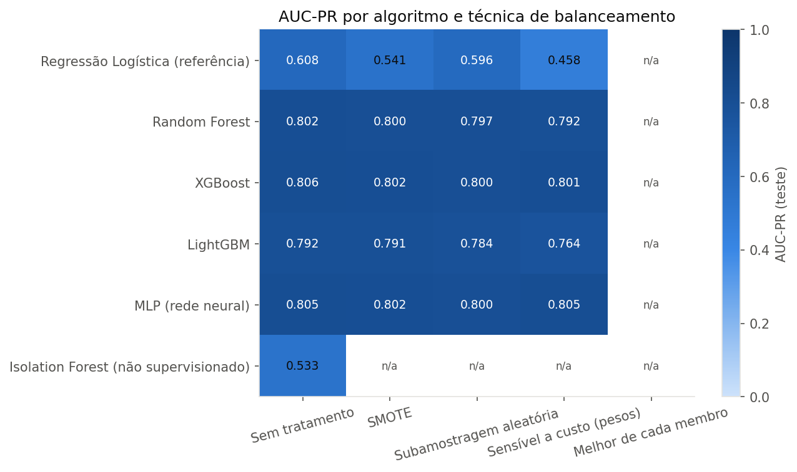
Fonte: elaborado pelo autor.

## Comparação dos algoritmos — PaySim completo

**Tabela 5** – Desempenho no conjunto de teste — PaySim completo
| Algoritmo | Balanceamento | AUC-PR CV | AUC-PR teste [IC 95%] | AUC-ROC | Precisão | Revocação | F1 | MCC | Latência (ms) |
|---|---|---|---|---|---|---|---|---|---|
| Random Forest | SMOTE | 0,996 ± 0,002 | 0,993 [0,983; 1,000] | 0,998 | 0,988 | 0,985 | 0,986 | 0,986 | 16,62 |
| Random Forest | Sensível a custo (pesos) | 0,996 ± 0,002 | 0,993 [0,983; 0,999] | 0,997 | 1,000 | 0,988 | 0,994 | 0,994 | 16,71 |
| MLP (rede neural) | SMOTE | 0,994 ± 0,003 | 0,992 [0,982; 0,999] | 0,998 | 0,945 | 0,985 | 0,964 | 0,964 | 3,39 |
| Random Forest | Subamostragem aleatória | 0,995 ± 0,002 | 0,992 [0,982; 1,000] | 0,997 | 0,994 | 0,985 | 0,989 | 0,989 | 16,72 |
| LightGBM | Subamostragem aleatória | 0,995 ± 0,002 | 0,992 [0,982; 0,999] | 0,995 | 1,000 | 0,988 | 0,994 | 0,994 | 4,52 |
| MLP (rede neural) | Sensível a custo (pesos) | 0,994 ± 0,002 | 0,991 [0,980; 0,999] | 0,998 | 0,964 | 0,985 | 0,974 | 0,974 | 3,38 |
| XGBoost | SMOTE | 0,995 ± 0,002 | 0,991 [0,980; 1,000] | 0,997 | 0,962 | 0,988 | 0,975 | 0,975 | 4,35 |
| LightGBM | SMOTE | 0,995 ± 0,002 | 0,991 [0,979; 1,000] | 0,995 | 1,000 | 0,988 | 0,994 | 0,994 | 4,41 |
| XGBoost | Subamostragem aleatória | 0,995 ± 0,002 | 0,990 [0,979; 0,999] | 0,996 | 0,950 | 0,988 | 0,969 | 0,969 | 4,24 |
| MLP (rede neural) | Sem tratamento | 0,992 ± 0,005 | 0,990 [0,980; 0,998] | 0,999 | 0,997 | 0,979 | 0,988 | 0,988 | 3,39 |
| LightGBM | Sem tratamento | 0,995 ± 0,002 | 0,990 [0,978; 0,998] | 0,995 | 0,997 | 0,985 | 0,991 | 0,991 | 4,37 |
| XGBoost | Sem tratamento | 0,995 ± 0,002 | 0,989 [0,978; 0,998] | 0,995 | 0,982 | 0,988 | 0,985 | 0,985 | 4,22 |
| XGBoost | Sensível a custo (pesos) | 0,995 ± 0,002 | 0,989 [0,977; 0,998] | 0,995 | 0,997 | 0,988 | 0,992 | 0,992 | 4,25 |
| Random Forest | Sem tratamento | 0,994 ± 0,002 | 0,989 [0,977; 0,997] | 0,995 | 0,988 | 0,988 | 0,988 | 0,988 | 16,71 |
| LightGBM | Sensível a custo (pesos) | 0,994 ± 0,002 | 0,989 [0,976; 0,997] | 0,995 | 1,000 | 0,988 | 0,994 | 0,994 | 4,40 |
| Regressão Logística (referência) | Subamostragem aleatória | 0,990 ± 0,002 | 0,986 [0,972; 0,996] | 0,997 | 0,973 | 0,982 | 0,977 | 0,977 | 3,36 |
| MLP (rede neural) | Subamostragem aleatória | 0,990 ± 0,003 | 0,985 [0,971; 0,996] | 0,998 | 0,985 | 0,979 | 0,982 | 0,982 | 3,39 |
| Regressão Logística (referência) | SMOTE | 0,990 ± 0,002 | 0,984 [0,971; 0,994] | 0,998 | 0,939 | 0,982 | 0,960 | 0,960 | 3,36 |
| Regressão Logística (referência) | Sem tratamento | 0,988 ± 0,003 | 0,982 [0,966; 0,994] | 0,991 | 0,988 | 0,976 | 0,982 | 0,982 | 3,45 |
| Regressão Logística (referência) | Sensível a custo (pesos) | 0,900 ± 0,044 | 0,877 [0,847; 0,903] | 0,997 | 0,807 | 0,982 | 0,886 | 0,890 | 3,37 |
| Isolation Forest (não supervisionado) | Sem tratamento | 0,553 ± 0,023 | 0,571 [0,518; 0,625] | 0,981 | 0,899 | 0,517 | 0,656 | 0,681 | 4,10 |
Precisão, revocação, F1 e MCC no limiar de custo mínimo do cenário moderado (FN:FP = 20:1), escolhido nas predições out-of-fold do treino. CV: média ± desvio-padrão em 5 partições. Fonte: elaborado pelo autor.

**Figura 5** – AUC-PR no teste por algoritmo e balanceamento — PaySim completo
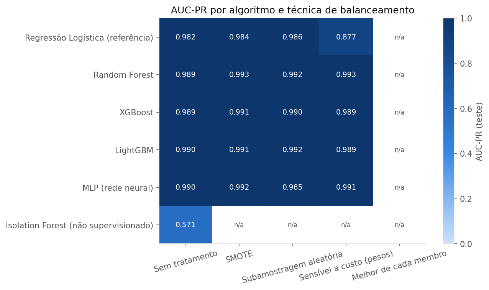
Fonte: elaborado pelo autor.

## O atalho do simulador PaySim

**Tabela 6** – Frequência de padrões de saldo em fraudes e legítimas (PaySim, TRANSFER e CASH_OUT)
| Regra | Fraudes (%) | Legítimas (%) |
|---|---|---|
| valor igual ao saldo da origem | 97,8 | 0,0 |
| saldo da origem zerado após a transação | 97,6 | 42,7 |
| saldo da origem bate exatamente (antes − valor = depois) | 99,5 | 9,9 |
Base inteira: 2.770.409 transações, 8.213 fraudes. Fonte: elaborado pelo autor.

## Comparação estatística e escolha do modelo final
CV repetida 5×3 no treino (15 partições, as mesmas para todas as configurações), teste de Friedman com pós-teste de Nemenyi e teste t corrigido de Nadeau-Bengio contra a melhor configuração, com ajuste de Holm (α = 0,05).

**Tabela 7** – Testes de comparação múltipla
| Base | Configurações | χ² de Friedman | p | Diferença crítica (Nemenyi) | Não significativamente piores que a melhor |
|---|---|---|---|---|---|
| ULB (cartão de crédito) | 31 | 327,52 | 9,5e-52 | 12,50 | 25 |
| PaySim sem saldo da origem | 31 | 373,10 | 7,3e-61 | 12,50 | 15 |
Fonte: elaborado pelo autor.

**Tabela 8** – Configuração escolhida por cada critério
| Base | Critério | Configuração | AUC-PR CV repetida | p (Holm) vs. melhor | Latência (ms) | AUC-PR teste |
|---|---|---|---|---|---|---|
| ULB (cartão de crédito) | Maior média | Ensemble XGBoost + LightGBM | 0,857 | 1,000 | 2,90 | 0,847 |
| ULB (cartão de crédito) | Regra original | MLP (rede neural) + SMOTE | 0,824 | 0,383 | 1,54 | 0,814 |
| ULB (cartão de crédito) | Regra com margem prática | XGBoost + Sensível a custo (pesos) [busca n=50] | 0,857 | 1,000 | 2,05 | 0,839 |
| PaySim sem saldo da origem | Maior média | XGBoost + Sem tratamento [busca n=50] | 0,769 | 1,000 | 3,47 | 0,809 |
| PaySim sem saldo da origem | Regra original | MLP (rede neural) + SMOTE | 0,761 | 0,216 | 2,74 | 0,802 |
| PaySim sem saldo da origem | Regra com margem prática | MLP (rede neural) + Subamostragem aleatória | 0,761 | 0,395 | 2,80 | 0,800 |
Regra original: a de menor latência entre as não significativamente piores que a melhor. Regra com margem prática: além disso, até 0,01 de AUC-PR abaixo da melhor; latências até 0,5 ms acima da mínima contam como empate, e vence a de maior AUC-PR. Fonte: elaborado pelo autor.

**Figura 6** – Ranking médio na CV repetida e diferença crítica de Nemenyi — ULB (cartão de crédito)
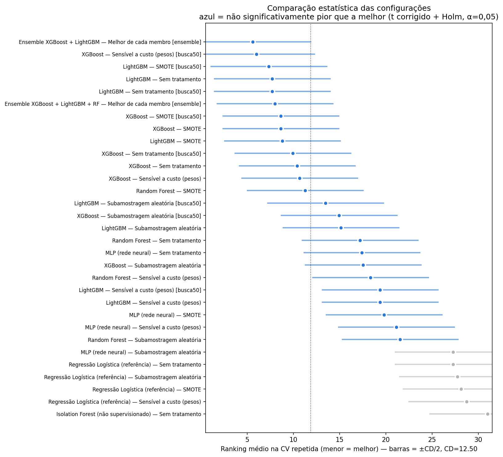
Fonte: elaborado pelo autor.

**Figura 7** – Ranking médio na CV repetida e diferença crítica de Nemenyi — PaySim sem saldo da origem
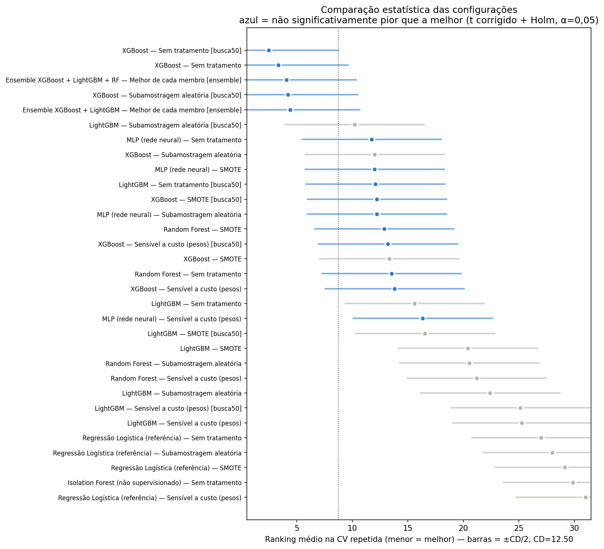
Fonte: elaborado pelo autor.

## Modelos finais

**Tabela 9** – Desempenho dos modelos finais no conjunto de teste
| Base | Configuração | Calibração | Limiar | AUC-PR | AUC-ROC | Precisão | Revocação | F1 | MCC | VP | FP | FN | Latência média (ms) | Latência p99 (ms) |
|---|---|---|---|---|---|---|---|---|---|---|---|---|---|---|
| ULB (cartão de crédito) | XGBoost + Sensível a custo (pesos) | Platt | 0,0345 | 0,839 | 0,980 | 0,767 | 0,832 | 0,798 | 0,798 | 79 | 24 | 16 | 2,27 | 3,22 |
| PaySim sem saldo da origem | MLP (rede neural) + Subamostragem aleatória | Isotônica | 0,0714 | 0,792 | 0,953 | 0,859 | 0,760 | 0,806 | 0,807 | 250 | 41 | 79 | 2,80 | 3,03 |
| PaySim completo | Random Forest + Sensível a custo (pesos) | Isotônica | 1,0000 | 0,991 | 0,997 | 1,000 | 0,988 | 0,994 | 0,994 | 325 | 0 | 4 | 16,91 | 18,94 |
Limiar de custo mínimo do cenário moderado, na escala calibrada. VP/FP/FN: verdadeiros positivos, falsos positivos e falsos negativos. Fonte: elaborado pelo autor.

## Calibração das probabilidades
Método escolhido pelo menor Brier em validação cruzada interna sobre as predições out-of-fold do treino; valores medidos no teste.

**Tabela 10** – Métricas de calibração no teste, antes e depois da calibração
| Base | Método | Brier antes | Brier depois | ECE antes | ECE depois | Log loss antes | Log loss depois | AUC-PR antes | AUC-PR depois |
|---|---|---|---|---|---|---|---|---|---|
| ULB (cartão de crédito) | Platt | 0,00054 | 0,00050 | 0,00049 | 0,00024 | 0,00383 | 0,00292 | 0,839 | 0,839 |
| PaySim sem saldo da origem | Isotônica | 0,00088 | 0,00095 | 0,00082 | 0,00050 | 0,00581 | 0,00581 | 0,800 | 0,792 |
| PaySim completo | Isotônica | 0,00007 | 0,00004 | 0,00050 | 0,00002 | 0,00079 | 0,00038 | 0,993 | 0,991 |
ECE: erro de calibração esperado (10 faixas). Fonte: elaborado pelo autor.

**Figura 8** – Diagrama de confiabilidade do modelo final — ULB
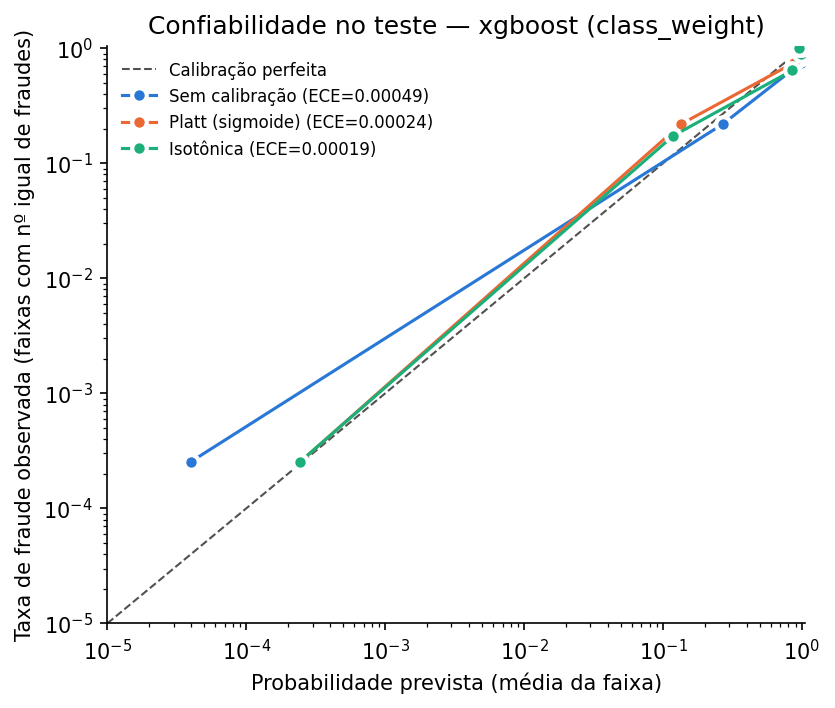
Fonte: elaborado pelo autor.

## Função de custo

**Tabela 11** – Custo do modelo final nos quatro cenários, comparado às políticas triviais
| Base | Cenário | Limiar | Custo | Aprovar tudo | Bloquear tudo | Economia vs. aprovar tudo (%) | Economia vs. melhor trivial (%) |
|---|---|---|---|---|---|---|---|
| ULB (cartão de crédito) | Conservador (FN 100, FP 10) | 0,106467 | 2.060,00 | 9.500,00 | 550.380,00 | 78,3 | 78,3 |
| ULB (cartão de crédito) | Moderado (FN 100, FP 5) | 0,034511 | 1.720,00 | 9.500,00 | 275.190,00 | 81,9 | 81,9 |
| ULB (cartão de crédito) | Agressivo (FN 100, FP 1) | 0,005592 | 1.418,00 | 9.500,00 | 55.038,00 | 85,1 | 85,1 |
| ULB (cartão de crédito) | Valor da transação (FN = valor, piso 25; FP 5) | 0,075533 | 3.739,56 | 14.760,99 | 275.190,00 | 74,7 | 74,7 |
| PaySim sem saldo da origem | Conservador (FN 100, FP 10) | 0,178947 | 8.870,00 | 32.900,00 | 1.104.880,00 | 73,0 | 73,0 |
| PaySim sem saldo da origem | Moderado (FN 100, FP 5) | 0,071429 | 8.105,00 | 32.900,00 | 552.440,00 | 75,4 | 75,4 |
| PaySim sem saldo da origem | Agressivo (FN 100, FP 1) | 0,015015 | 6.740,00 | 32.900,00 | 110.488,00 | 79,5 | 79,5 |
| PaySim sem saldo da origem | Valor da transação (FN = valor, piso 25; FP 5) | 0,000029 | 493.120,00 | 475.453.302,21 | 552.440,00 | 99,9 | 10,7 |
| PaySim completo | Conservador (FN 100, FP 10) | 1,000000 | 400,00 | 32.900,00 | 1.104.880,00 | 98,8 | 98,8 |
| PaySim completo | Moderado (FN 100, FP 5) | 1,000000 | 400,00 | 32.900,00 | 552.440,00 | 98,8 | 98,8 |
| PaySim completo | Agressivo (FN 100, FP 1) | 0,035714 | 433,00 | 32.900,00 | 110.488,00 | 98,7 | 98,7 |
| PaySim completo | Valor da transação (FN = valor, piso 25; FP 5) | 0,000514 | 357.711,84 | 475.453.302,21 | 552.440,00 | 99,9 | 35,2 |
Melhor trivial: a mais barata entre aprovar e bloquear todas as transações. Fonte: elaborado pelo autor.

**Figura 9** – Custo em função do limiar, cenário moderado — ULB
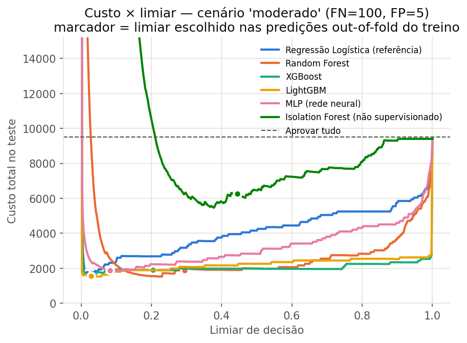
Fonte: elaborado pelo autor.

## Explicabilidade

**Tabela 12** – Cinco atributos mais importantes (média do |SHAP|) no modelo final de cada base
| Posição | ULB (cartão de crédito) | PaySim sem saldo da origem | PaySim completo |
|---|---|---|---|
| 1 | V14 (2,23) | dest_zero_before_after (0,27) | error_balance_orig_log (0,36) |
| 2 | V4 (1,91) | amount_log (0,18) | newbalanceOrig_log (0,06) |
| 3 | V12 (1,14) | type_TRANSFER (0,11) | orig_emptied (0,05) |
| 4 | V10 (1,10) | hour_sin (0,07) | oldbalanceOrg_log (0,04) |
| 5 | V3 (0,96) | type_CASH_OUT (0,06) | amount_to_balance_ratio (0,02) |
Atributos no espaço após a engenharia de atributos. Fonte: elaborado pelo autor.

**Tabela 13** – Concordância entre SHAP e LIME nas explicações locais
| Base | Caso | Probabilidade | Sobreposição SHAP × LIME (top 5) |
|---|---|---|---|
| ULB (cartão de crédito) | verdadeiro positivo | 0,9994 | 4 |
| ULB (cartão de crédito) | falso positivo | 0,9860 | 4 |
| ULB (cartão de crédito) | falso negativo | 0,0214 | 2 |
| PaySim sem saldo da origem | verdadeiro positivo | 1,0000 | 3 |
| PaySim sem saldo da origem | falso positivo | 0,9400 | 3 |
| PaySim sem saldo da origem | falso negativo | 0,0286 | 4 |
| PaySim completo | verdadeiro positivo | 1,0000 | 2 |
| PaySim completo | falso negativo | 0,0005 | 1 |
Número de atributos em comum entre os cinco mais relevantes de cada método. Fonte: elaborado pelo autor.

**Figura 10** – Distribuição dos valores SHAP por atributo — ULB (cartão de crédito)
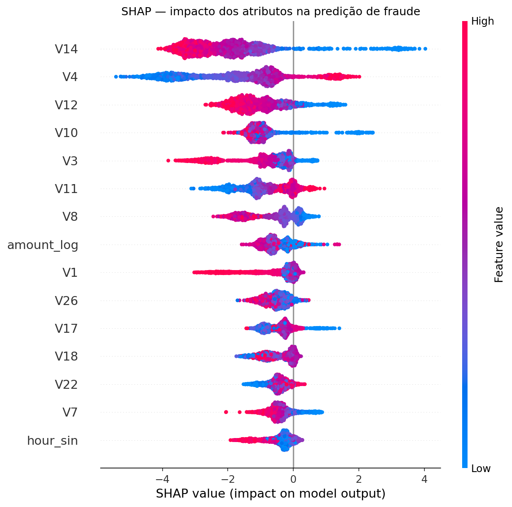
Fonte: elaborado pelo autor.

**Figura 11** – Distribuição dos valores SHAP por atributo — PaySim sem saldo da origem
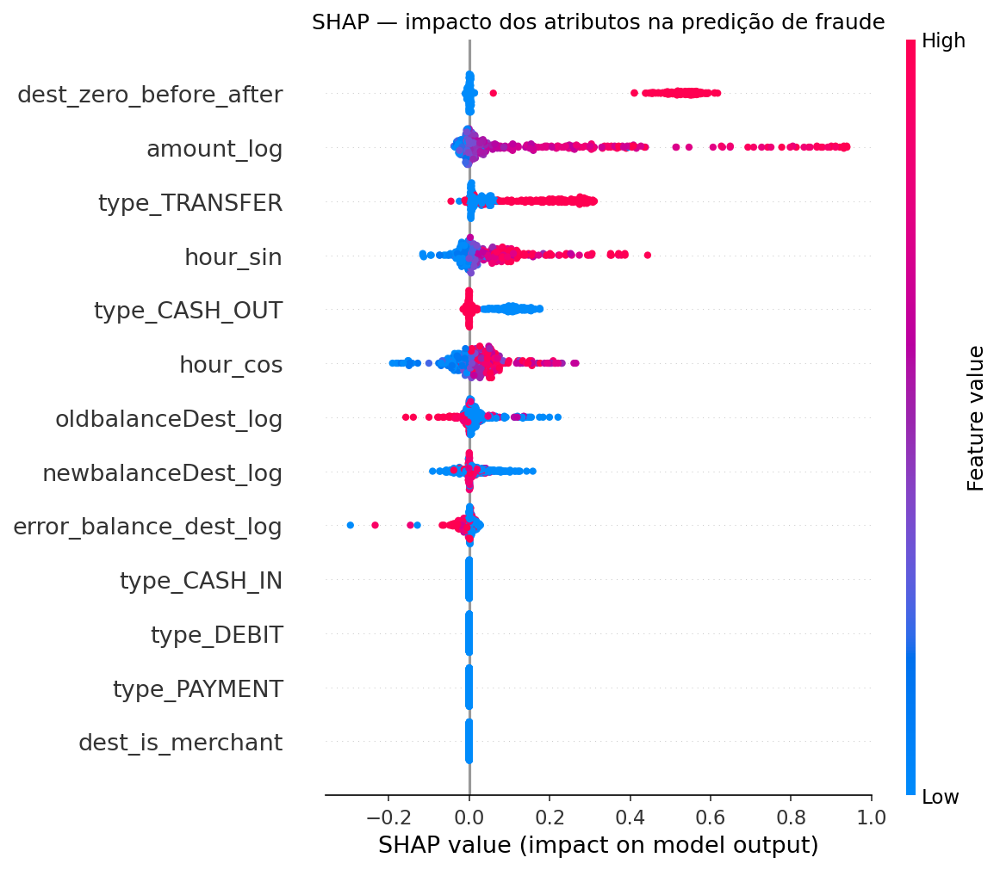
Fonte: elaborado pelo autor.

**Figura 12** – Distribuição dos valores SHAP por atributo — PaySim completo
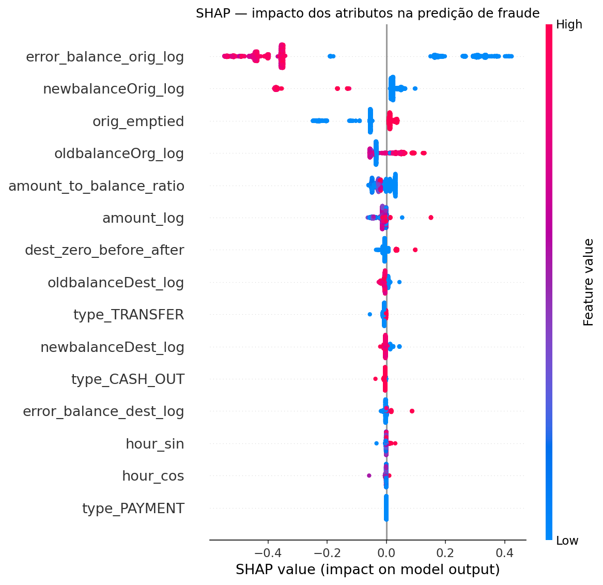
Fonte: elaborado pelo autor.

**Figura 13** – Explicação local (SHAP) de uma fraude detectada — ULB
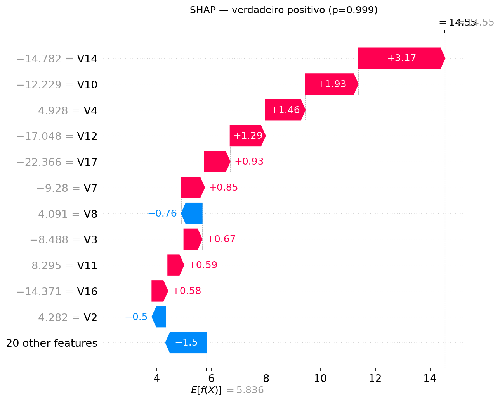
Fonte: elaborado pelo autor.

## Concept drift
Treino nos primeiros 40% da linha do tempo e teste em 6 janelas consecutivas. Estático: nunca retreinado; janela deslizante: retreinado com a janela anterior; acumulado: retreinado com todo o histórico disponível.

**Tabela 14** – AUC-PR média nas janelas temporais, por estratégia de retreino
| Base | Atraso dos rótulos (janelas) | Estático | Janela deslizante | Acumulado | Pior janela (estático) | PSI máximo do escore | Fraudes por janela |
|---|---|---|---|---|---|---|---|
| ULB (cartão de crédito) | 0 | 0,766 | 0,771 | 0,777 | 0,661 | 0,373 | 22–80 |
| ULB (cartão de crédito) | 1 | 0,766 | 0,767 | 0,775 | 0,661 | 0,373 | 22–80 |
| PaySim sem saldo da origem | 0 | 0,776 | 0,767 | 0,775 | 0,728 | 0,054 | 70–731 |
| PaySim sem saldo da origem | 1 | 0,776 | 0,769 | 0,776 | 0,728 | 0,054 | 70–731 |
| PaySim completo | 0 | 0,998 | 0,998 | 0,998 | 0,986 | 0,009 | 70–731 |
PSI acima de 0,25 indica mudança relevante de distribuição. Fonte: elaborado pelo autor.

**Figura 14** – AUC-PR por janela temporal — ULB (cartão de crédito)
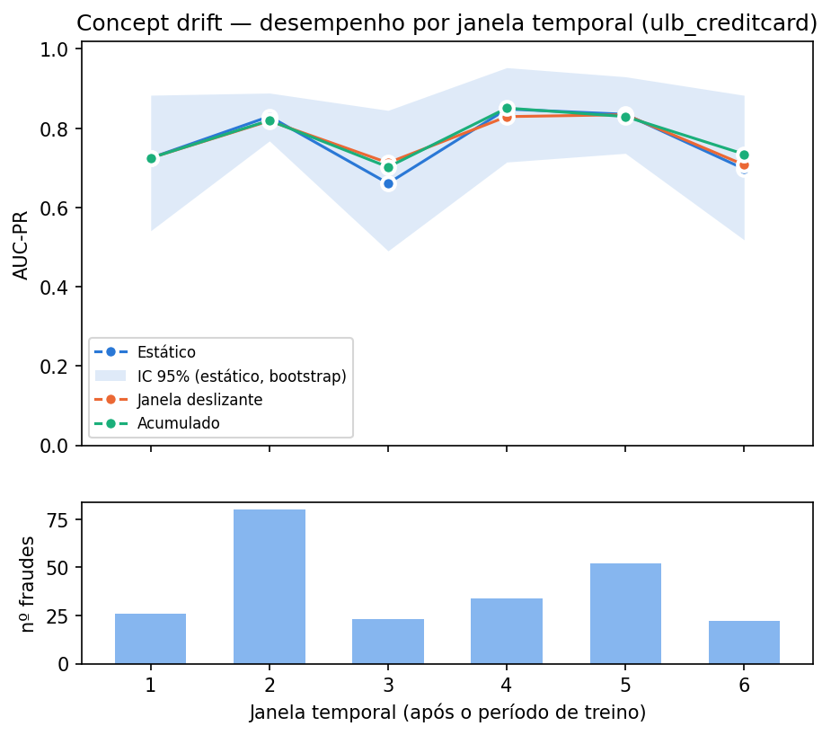
Fonte: elaborado pelo autor.

**Figura 15** – AUC-PR por janela temporal — PaySim sem saldo da origem
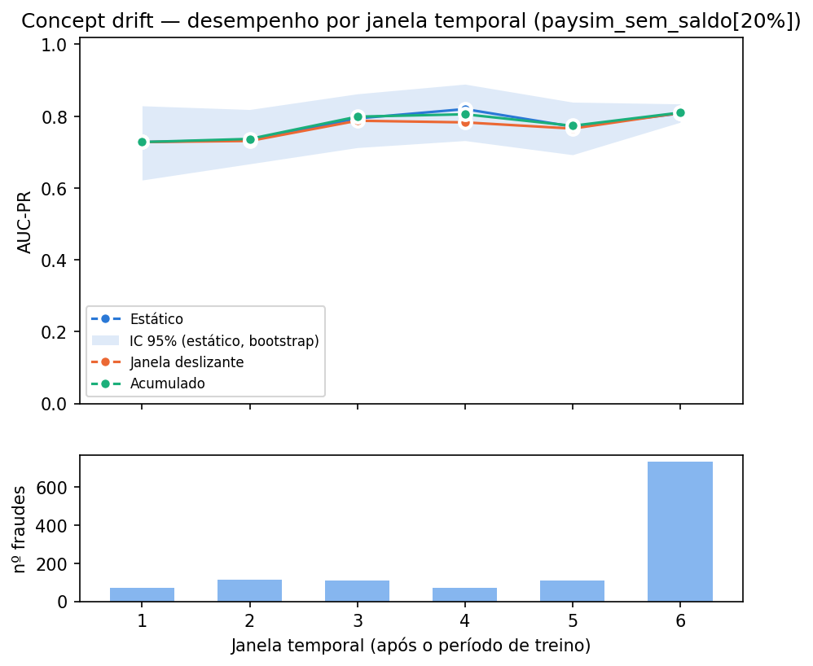
Fonte: elaborado pelo autor.

## Pontos para a discussão
- **Vazamento por duplicatas.** 8 das 98 fraudes do teste tinham cópia exata no treino. Removê-las mudou a AUC-PR no teste em -0,034 em média, contra -0,003 na CV: o vazamento inflava sobretudo a estimativa no teste.
- **Poder do teste estatístico e regra de seleção.** Com 15 partições, 25 de 31 configurações não diferem significativamente da melhor na ULB. A regra original escolheria MLP (rede neural) + SMOTE (AUC-PR 0,824, 1,54 ms), 0,033 abaixo da melhor para economizar 0,51 ms. A margem prática levou a XGBoost + Sensível a custo (pesos) [busca n=50] (AUC-PR 0,857, 2,05 ms). A regra foi revista depois de ver os resultados, o que deve ser declarado no texto.
- **Atalho do PaySim.** A regra "valor igual ao saldo da origem" vale para 97,8% das fraudes e 0,0% das legítimas. Com todos os atributos, a AUC-PR de teste dos modelos supervisionados fica entre 0,877 e 0,993 (regressão logística: 0,986); sem os saldos da origem, entre 0,458 e 0,806.
- **Economia enganosa.** No cenário de custo pelo valor, PaySim sem saldo da origem mostra 99,9% de economia contra aprovar tudo, mas 10,7% contra a melhor política trivial: com fraudes de centenas de milhares e FP fixo em 5, o limiar ótimo cai para perto de zero. Os custos de erro precisam estar na escala dos valores da base.
- **Calibração.** Reduziu o Brier em ULB (cartão de crédito) (0,00054 → 0,00050), PaySim completo (0,00007 → 0,00004). Piorou no teste em PaySim sem saldo da origem (Isotônica: 0,00088 → 0,00095): a escolha feita no treino nem sempre se confirma no teste.
- **Drift.** AUC-PR média por estratégia — ULB (cartão de crédito): estático 0,766, acumulado 0,777, PSI máx. 0,373; PaySim sem saldo da origem: estático 0,776, acumulado 0,775, PSI máx. 0,054; PaySim completo: estático 0,998, acumulado 0,998, PSI máx. 0,009. O retreino trouxe ganho pequeno na ULB e nenhum no PaySim, cujo simulador gera fraudes pelo mesmo processo o tempo todo (PSI baixo). Poucas fraudes por janela deixam os intervalos de confiança largos, e a ULB cobre só dois dias.
- **Abordagem não supervisionada.** O Isolation Forest ficou com AUC-PR 0,238 na ULB, muito abaixo dos supervisionados, embora sua AUC-ROC seja 0,958: em bases desbalanceadas a ROC esconde a quantidade de falsos positivos.
